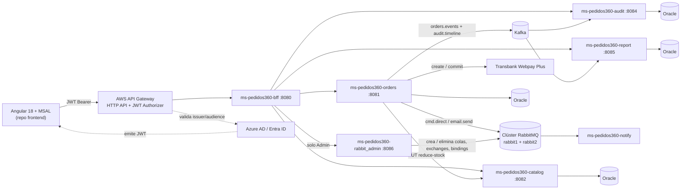
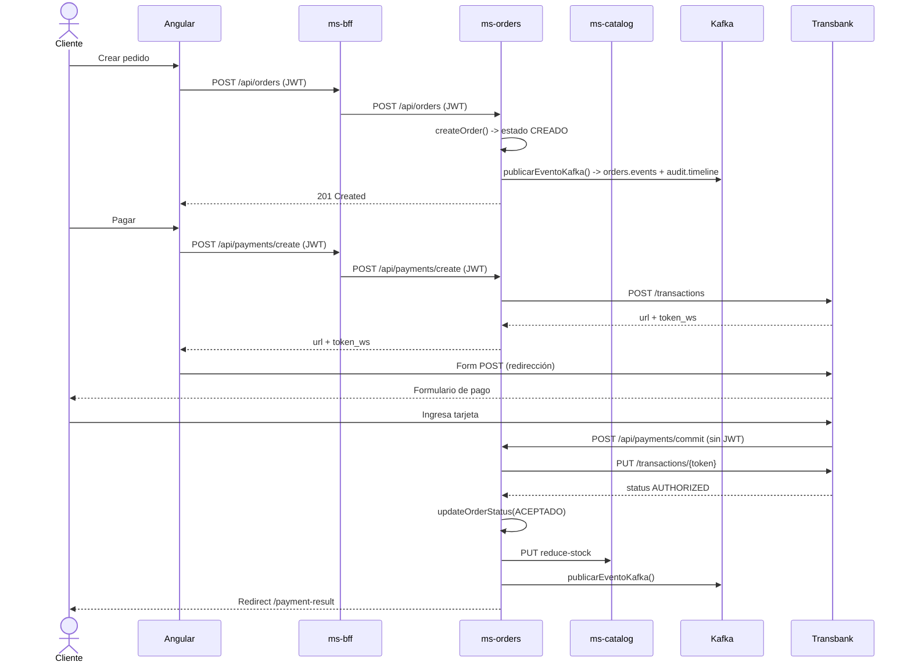
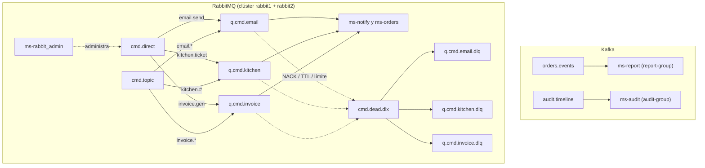

# Pedidos360 — Backend

Plataforma logística que centraliza la gestión de pedidos, catálogo de productos, notificaciones, auditoría de eventos de negocio y reportería operacional, mediante una arquitectura de microservicios Spring Boot con autenticación corporativa federada (Azure AD) y mensajería asíncrona dual (Kafka + RabbitMQ en clúster de dos nodos), más un microservicio administrador de la topología de RabbitMQ.

Este repositorio contiene el backend completo. El frontend (Angular 18 + MSAL) vive en un repositorio separado: [`pedidos360-frontend`](https://github.com/meninaaa/pedidos360-frontend).

## Arquitectura

| Servicio | Puerto | Responsabilidad |
|---|---|---|
| `ms-pedidos360-bff` | 8080 | Entrada HTTP para el cliente, propaga el JWT entrante y reenvía hacia los microservicios internos vía `RestTemplate`. |
| `ms-pedidos360-orders` | 8081 | CRUD de pedidos, máquina de estados, coordinación de descuento de stock contra `catalog`, integración de pagos con Transbank Webpay Plus, productor de eventos Kafka y comandos RabbitMQ. |
| `ms-pedidos360-catalog` | 8082 | CRUD de productos, control de stock, expone el endpoint interno de descuento usado por `orders`. |
| `ms-pedidos360-notify` | 8083 | Consumidor de RabbitMQ para el envío de notificaciones (sin base de datos propia). |
| `ms-pedidos360-audit` | 8084 | Consume eventos de Kafka y los persiste como registro inmutable de auditoría en `audit_logs`. |
| `ms-pedidos360-report` | 8085 | Consume eventos de Kafka, los persiste en `report_logs` y calcula KPIs (ventas, pedidos activos, lead time) a partir del histórico. |
| `ms-pedidos360-rabbit_admin` | 8086 | **Microservicio administrador de RabbitMQ.** API REST para crear colas, exchanges y bindings y eliminar colas y exchanges del clúster, con validación de entrada. Acceso restringido al rol `Admin`. |
| Oracle XE | 1521 (1522 en el host) | Base de datos, una instancia por servicio que la requiere (aislamiento de dominio). |
| Kafka + Zookeeper | 9092 / 29092 interno | Event streaming de eventos de negocio. |
| RabbitMQ (`rabbit1`, `rabbit2`) | 5672 y 5673 (AMQP) / 15672 y 15673 (consola) | Mensajería de comandos de trabajo, desplegada como clúster de dos nodos. |

## Diagramas

### Arquitectura general



### Secuencia: creación y pago de un pedido



### Topología de mensajería



## Flujo principal de un pedido

1. El cliente llama a `ms-pedidos360-bff` con un token JWT emitido por Azure AD.
2. El BFF reenvía la petición hacia `ms-pedidos360-orders`, propagando el header `Authorization`.
3. `OrderController.crearPedido(...)` recibe el request y delega en `OrderService.createOrder(...)`.
4. `createOrder(...)` persiste el pedido en estado `CREADO`, publica el evento correspondiente y encola una notificación.
5. Al cambiar de estado vía `PUT /{id}/status`, `OrderController.cambiarEstado(...)` valida la transición (no se puede `DESPACHADO` sin pasar antes por `ACEPTADO`/`EN_PREPARACION`) y delega en `OrderService.updateOrderStatus(...)`.
6. Si el nuevo estado es `ACEPTADO`, `coordinarDescuentoStock(...)` llama de forma síncrona a `ms-pedidos360-catalog` (`PUT /api/catalog/products/{id}/reduce-stock`), propagando el JWT original extraído del `HttpServletRequest`.
7. Cada cambio de estado dispara `publicarEventoKafka(...)`, que publica el pedido serializado en **dos** tópicos: `orders.events` y `audit.timeline`.
8. `ms-pedidos360-report` consume `orders.events` y `ms-pedidos360-audit` consume `audit.timeline`, cada uno con su propio `group-id` (`report-group`, `audit-group`). Ambos reintentan 3 veces ante un fallo y, si persiste, el mensaje pasa al tópico `.DLT` correspondiente.

Las transiciones de estado válidas son: `CREADO → ACEPTADO → EN_PREPARACION → DESPACHADO → ENTREGADO / CANCELADO`.

## Kafka

Kafka se usa para publicar hechos de negocio ya ocurridos (un pedido fue creado, un pedido cambió de estado), que son consumidos de forma independiente por auditoría y reportería sin acoplar al productor con sus consumidores.

### Tópicos

| Tópico | Productor | Consumidor | Uso |
|---|---|---|---|
| `orders.events` | `ms-pedidos360-orders` | `ms-pedidos360-report` (`report-group`) | Fuente para el cálculo de KPIs: ventas totales, pedidos activos, lead time promedio. |
| `audit.timeline` | `ms-pedidos360-orders` | `ms-pedidos360-audit` (`audit-group`) | Timeline inmutable de trazabilidad de pedidos. |

### Publicación

El método `publicarEventoKafka(Order order)` en `OrderService.java` serializa el pedido completo con `ObjectMapper` y lo envía a ambos tópicos en la misma operación:

```java
kafkaTemplate.send("orders.events", eventPayload);
kafkaTemplate.send("audit.timeline", eventPayload);
```

Se invoca desde `createOrder(...)` (al crear un pedido) y desde `updateOrderStatus(...)` (en cada transición de estado).

### Consumo

- **`ms-pedidos360-audit`** — `AuditConsumerService.consumeEvent(...)` escucha `audit.timeline` con `group-id: audit-group`, construye un `AuditLog` con `eventType = "ORDER_EVENT"`, actor `SYSTEM` y el payload (recortado a 3.900 caracteres por el límite de la columna en Oracle), y lo persiste vía `AuditLogRepository`. Usa `@RetryableTopic` con 3 intentos y sufijo `.DLT` para los mensajes que no se pueden procesar.
- **`ms-pedidos360-report`** — `ReportMetricsService.consumeOrderEvent(...)` escucha `orders.events` con `group-id: report-group` (también con `@RetryableTopic`, 3 intentos y `.DLT`). Persiste cada evento como `OrderEventLog` en `report_logs` y actualiza en memoria los contadores agregados mediante `aplicarEvento(...)`:
  - `CREADO` → incrementa `pedidosActivos`.
  - `ENTREGADO` → decrementa `pedidosActivos`, suma a `ventasTotales` y calcula el lead time (`Duration` entre el timestamp de creación y el de entrega).
  - `CANCELADO` → decrementa `pedidosActivos`.
  - Al arrancar, `@PostConstruct reconstruirEstadoDesdeBaseDeDatos()` relee todo `report_logs` y reproduce los eventos en orden, para que las métricas sobrevivan un reinicio del contenedor.

### Configuración

```yaml
spring:
  kafka:
    bootstrap-servers: ${SPRING_KAFKA_BOOTSTRAP_SERVERS:kafka-pedidos360:29092}
    producer:
      key-serializer: org.apache.kafka.common.serialization.StringSerializer
      value-serializer: org.apache.kafka.common.serialization.StringSerializer
    consumer:
      group-id: report-group   # o audit-group, según el servicio
      auto-offset-reset: earliest
      key-deserializer: org.apache.kafka.common.serialization.StringDeserializer
      value-deserializer: org.apache.kafka.common.serialization.StringDeserializer
```

```bash
docker compose up -d zookeeper kafka
```

## RabbitMQ

RabbitMQ transporta comandos dirigidos a una acción concreta (por ejemplo, "enviar este email"), a diferencia de Kafka, que transporta hechos de dominio que varios consumidores pueden leer de forma independiente.

### Clúster de dos nodos

RabbitMQ se despliega como un clúster de dos nodos definido en `infra/apps/compose.yml`:

| Nodo | Contenedor | AMQP | Management UI |
|---|---|---|---|
| `rabbit1` | `rabbit1-pedidos360` | 5672 | 15672 |
| `rabbit2` | `rabbit2-pedidos360` | 5673 | 15673 |

Ambos nodos comparten la misma `RABBITMQ_ERLANG_COOKIE`. `rabbit1` expone un healthcheck (`rabbitmq-diagnostics ping`) y `rabbit2` espera a que esté sano antes de ejecutar `stop_app` → `join_cluster rabbit@rabbit1` → `start_app`. Para comprobar el estado del clúster:

```bash
docker exec rabbit1-pedidos360 rabbitmqctl cluster_status
```

o desde el Management UI (`http://<host>:15672`, pestaña *Overview* → *Nodes*), donde deben aparecer los dos nodos en ejecución.

### Topología declarada

La topología se declara en una única clase `@Configuration` (`RabbitMQConfig`, en `ms-pedidos360-notify`), separada de la lógica de negocio, con beans `Exchange`, `Queue` y `Binding`.

**Exchanges**

| Exchange | Tipo | Uso |
|---|---|---|
| `cmd.direct` | direct | Ruteo exacto por routing key. |
| `cmd.topic` | topic | Ruteo por patrones (`email.*`, `kitchen.#`, `invoice.*`). |
| `cmd.dead.dlx` | direct | Dead-letter exchange: recibe los mensajes rechazados o descartados. |

**Colas y bindings**

| Cola principal | Binding direct | Binding topic | DLQ |
|---|---|---|---|
| `q.cmd.email` | `email.send` | `email.*` | `q.cmd.email.dlq` |
| `q.cmd.kitchen` | `kitchen.ticket` | `kitchen.#` | `q.cmd.kitchen.dlq` |
| `q.cmd.invoice` | `invoice.gen` | `invoice.*` | `q.cmd.invoice.dlq` |

Cada cola principal declara `x-dead-letter-exchange: cmd.dead.dlx` y como `x-dead-letter-routing-key` su misma routing key, con la que `cmd.dead.dlx` la enlaza a su DLQ.

### Productores y consumidores

El método `enviarNotificacionRabbitMQ(...)` en `OrderService.java` publica comandos de tipo `EMAIL_NOTIFICATION` en el exchange `cmd.direct` con la routing key `email.send`:

```java
rabbitTemplate.convertAndSend("cmd.direct", "email.send", envelope);
```

Se invoca al crear un pedido y en las transiciones a `ACEPTADO` y `DESPACHADO`. El envelope sigue el formato estándar:

```json
{
  "type": "EMAIL_NOTIFICATION",
  "eventId": "uuid",
  "timestamp": "2026-09-13T18:24:18",
  "traceId": "uuid",
  "correlationId": "123",
  "payload": { "mensaje": "El estado de su pedido #123 cambió a: ACEPTADO" }
}
```

`ms-pedidos360-notify` agrupa sus consumidores en `NotificationListener`, con un `@RabbitListener` sobre cada cola de comandos (`q.cmd.email`, `q.cmd.kitchen` y `q.cmd.invoice`).

### Confirmación y manejo de errores

Cada consumidor recibe el `Channel` y el `Message` y confirma de forma explícita (ACK manual):

| Situación | Comportamiento |
|---|---|
| Procesamiento correcto | `channel.basicAck(deliveryTag, false)`. |
| Error al procesar | `channel.basicNack(deliveryTag, false, false)`: rechazo sin requeue, por lo que el mensaje es enrutado por el DLX (`cmd.dead.dlx`) a la DLQ de su cola. |

## Microservicio administrador de RabbitMQ (`ms-pedidos360-rabbit_admin`)

Servicio independiente (puerto **8086**) que administra la topología del clúster RabbitMQ sin necesidad de entrar al Management UI ni de redeployar los demás servicios. Se conecta al clúster mediante `SPRING_RABBITMQ_HOST` y delega la lógica en `RabbitAdminService`, que usa `RabbitAdmin` de Spring AMQP para declarar y eliminar recursos.

### Responsabilidades

- Crear colas, exchanges (`direct` y `topic`) y bindings.
- Eliminar colas y exchanges existentes.
- Validar la entrada antes de tocar el broker: un nombre vacío o una configuración inválida se rechaza con **HTTP 400** y un mensaje claro, y no se crea ningún recurso.
- Restringir todas las operaciones al rol `Admin`.

### Operaciones expuestas

La API REST del administrador cuelga de la ruta base `/api/admin` (la misma que enruta el API Gateway hacia este servicio):

| Operación | Método HTTP | Rol requerido |
|---|---|---|
| Crear una cola | `POST` | Admin |
| Eliminar una cola | `DELETE` | Admin |
| Crear un exchange (`direct` o `topic`) | `POST` | Admin |
| Eliminar un exchange | `DELETE` | Admin |
| Crear un binding (exchange, cola y routing key) | `POST` | Admin |

Las solicitudes sin token válido o sin rol `Admin` son rechazadas, y los cambios aplicados son visibles de inmediato en el Management UI del clúster.

### Organización del código

El código vive en el paquete `com.pedidos360.rabbit_admin`. El controller REST recibe y valida la entrada, y la lógica de administración está en `RabbitAdminService`, que declara y elimina los recursos en el broker.

### Métricas de monitoreo (Management UI)

Para operar el clúster se observan cuatro métricas en el Management UI:

| Métrica | Dónde verla | Por qué importa |
|---|---|---|
| Colas activas | *Queues* | Confirma que la topología declarada existe. |
| Mensajes pendientes (*Ready* / *Unacked*) | *Queues* | Un crecimiento sostenido indica consumidores lentos o caídos. |
| Consumidores | *Queues* → detalle de cola | Una cola sin consumidores acumula mensajes. |
| Mensajes en DLQ | `q.cmd.*.dlq` | Cada mensaje allí es un fallo no recuperable que requiere revisión. |

## Pagos — Transbank Webpay Plus

`WebpayController.java` en `ms-pedidos360-orders` integra el ambiente de **integración (sandbox)** de Webpay Plus REST:

| Endpoint | Método | Autenticación | Descripción |
|---|---|---|---|
| `/api/payments/create` | `POST` | JWT (usuario autenticado) | Inicia la transacción contra Transbank y devuelve `url` + `token_ws`. |
| `/api/payments/commit` | `POST` | **Pública, sin JWT** | Recibida directamente desde el navegador tras el formulario de retorno de Transbank; confirma la transacción y, si fue `AUTHORIZED`, invoca `OrderService.updateOrderStatus(orderId, ACEPTADO)`. |

`/payments/commit` debe quedar exenta de autenticación en la configuración de seguridad y, si el backend corre detrás de AWS API Gateway, también debe existir como ruta específica sin JWT Authorizer — el POST de retorno de Transbank nunca lleva un header `Authorization`.

## API expuesta por el BFF

| Método | Ruta | Rol requerido | Descripción |
|---|---|---|---|
| `GET` | `/api/orders` | Admin | Listado global de pedidos. |
| `GET` | `/api/orders/pending` | Admin, Operador | Pedidos en curso y pendientes (sin estado final). |
| `GET` | `/api/orders/customer?email=` | Admin, Operador, Cliente | Pedidos del usuario autenticado. |
| `POST` | `/api/orders` | Admin, Operador, Cliente | Crear un pedido. |
| `PUT` | `/api/orders/{id}/status` | Admin, Operador | Cambiar el estado de un pedido. |
| `GET` | `/api/audit` | Admin, Operador | Timeline de auditoría (solo lectura). |
| `GET` | `/api/reports/summary` | Admin | KPIs agregados en vivo. |
| `GET` | `/api/reports/ventas-por-hora` | Admin | Serie de ventas agregadas por hora. |
| `GET` | `/api/reports/lead-time-trend` | Admin | Lead time por pedido entregado. |
| `POST` | `/api/payments/create` | Usuario autenticado | Inicia un pago Webpay. |
| `POST` | `/api/payments/commit` | Pública | Confirmación de pago (llamada por Transbank). |
| `*` | `/api/admin/**` | Admin | Administración de colas, exchanges y bindings de RabbitMQ (ver sección del administrador). |

## Seguridad

1. El frontend se autentica contra Azure AD vía MSAL y adjunta el JWT como `Authorization: Bearer <token>`.
2. En despliegue cloud, AWS API Gateway (HTTP API) valida `issuer` y `audience` con un JWT Authorizer antes de enrutar, incluida la ruta `/api/admin/*`.
3. Cada microservicio vuelve a validar el token de forma independiente (`spring.security.oauth2.resourceserver.jwt.issuer-uri`), y aplica autorización por rol con `@PreAuthorize("hasAnyRole(...)")`. La administración de RabbitMQ queda limitada a `Admin`.
4. El claim `roles` del JWT se mapea a authorities con prefijo `ROLE_`. Los roles usados en todo el sistema son, en español: `Admin`, `Operador`, `Cliente`.

## Pruebas

Las pruebas mínimas obligatorias de la pauta (sección 7 de la guía de la EP2) están cubiertas con pruebas automatizadas en JUnit 5 + Mockito + Spring Security Test, a excepción de dos que dependen de infraestructura en ejecución y se verifican manualmente (ver más abajo).

### Cobertura de la pauta

| # | Prueba de la pauta | Resultado esperado | Módulo | Prueba automatizada |
|---|---|---|---|---|
| 01 | Sin token | La solicitud protegida es rechazada. | `orders` | `SecurityTest#cuandoSinToken_entoncesRechazado` |
| 02 | Token inválido o expirado | La solicitud es rechazada. | `orders` | `SecurityTest#cuandoTokenInvalidoOExpirado_entoncesRechazado` |
| 03 | Token válido con rol autorizado | La solicitud es procesada correctamente. | `orders` | `SecurityTest#cuandoAdministradorAutenticado_entoncesProcesado` |
| 04 | Token válido sin permiso suficiente | La solicitud es rechazada por autorización. | `orders` | `SecurityTest#cuandoClienteIntentaAccesoAdmin_entoncesRechazadoPorPermisos` |
| 05 | Regla de negocio inválida | La operación no se ejecuta y no se publica ningún mensaje. | `orders` | `OrderServiceTest#cuandoTransicionEstadoInvalida_entoncesLanzaIllegalStateException` |
| 06 | Regla de negocio válida | La operación se completa, se publica el mensaje y se devuelve el JSON esperado. | `orders` | `OrderServiceTest#cuandoCrearOrdenValida_entoncesProcesaYGuarda` |
| 08 | Publicación y consumo normal (las tres colas) | El mensaje es consumido y confirmado con ACK. | `notify` | `NotifyResilienceTest#cuandoConsumoEmailExitoso_entoncesConfirmaConAck`, `...KitchenExitoso...`, `...InvoiceExitoso...` |
| 09 | Mensaje con error no recuperable (las tres colas) | NACK sin requeue; el mensaje llega a la DLQ. | `notify` | `NotifyResilienceTest#cuandoErrorProcesamientoEmail_entoncesEnviaNackSinRequeueADlq`, `...Kitchen...`, `...Invoice...` |
| 10 | Error recuperable | Reintentos acotados y, si persiste, el mensaje termina en la DLQ. | `notify` | Suite completa `NotifyResilienceTest` |
| 11 | Administrador: crear recurso válido | El recurso se declara correctamente en el broker. | `rabbit_admin` | `RabbitAdminTest#cuandoCrearColaValida_entoncesCreaRecursoExitosamente` |
| 12 | Administrador: eliminar recurso | El recurso se elimina con éxito. | `rabbit_admin` | `RabbitAdminTest#cuandoEliminarColaExistente_entoncesBorraRecurso` |
| 13 | Administrador: nombre vacío o configuración inválida | Se rechaza con HTTP 400 y no se crea nada. | `rabbit_admin` | `RabbitAdminTest#cuandoNombreColaVacio_entoncesLanzaExcepcionBadRequest` |

### Pruebas verificadas manualmente

| # | Prueba | Cómo verificarla |
|---|---|---|
| 07 | Estado del clúster | `rabbitmqctl cluster_status` o Management UI (puerto 15672): los dos nodos en ejecución. |
| 14 | Política de retención | Superar el límite o la expiración definidos y comprobar que los mensajes se descartan o pasan a la DLQ. |

### Ejecución

Desde la raíz de cada módulo:

```bash
./mvnw test
```

o una prueba puntual:

```bash
./mvnw test -Dtest="SecurityTest#cuandoSinToken_entoncesRechazado"
```

### Integración continua

El workflow de GitHub Actions `Pedidos360 - Pruebas solicitadas en la pauta` (`.github/workflows`) ejecuta cada prueba de la tabla anterior como un job independiente de la matriz, de modo que cada fila de la pauta queda como un check separado con su resultado esperado registrado en el resumen de la ejecución. Se dispara en cada `push` y `pull_request` hacia `main`, `master` y `develop`, y manualmente con `workflow_dispatch`. Si una prueba falla, se suben los reportes de Surefire como artefacto.

## Requisitos

- Docker y Docker Compose.
- Para ejecutar un servicio fuera de Docker: JDK 21 y Maven Wrapper.
- App Registration en Azure AD con los scopes/roles configurados (`Admin`, `Operador`, `Cliente`).
- Credenciales de prueba de Transbank (ambiente de integración, ya embebidas en `WebpayController` para sandbox).

## Configuración

Variables relevantes por servicio (`application.yml`):

```yaml
spring:
  datasource:
    url: jdbc:oracle:thin:@oracle-pedidos360:1521/XEPDB1
  jpa:
    hibernate:
      ddl-auto: update   # genera el esquema si la tabla no existe aún
  kafka:
    bootstrap-servers: ${SPRING_KAFKA_BOOTSTRAP_SERVERS:kafka-pedidos360:29092}
  rabbitmq:
    host: ${SPRING_RABBITMQ_HOST:rabbit1-pedidos360}
  security:
    oauth2:
      resourceserver:
        jwt:
          issuer-uri: https://login.microsoftonline.com/<TENANT_ID>/v2.0
          audiences: <API_CLIENT_ID>
```

## Ejecución con Docker Compose

```bash
git clone https://github.com/meninaaa/pedidos360-backend.git
cd pedidos360-backend/infra/apps
docker compose up -d --build
```

Swagger de cada servicio disponible en `http://localhost:<puerto>/swagger-ui.html`.

URLs útiles:
- BFF: `http://localhost:8080`
- Administrador de RabbitMQ: `http://localhost:8086`
- RabbitMQ Management (nodo 1): `http://localhost:15672` (guest / guest)
- RabbitMQ Management (nodo 2): `http://localhost:15673` (guest / guest)

## Despliegue en AWS

- **EC2** (recomendado `t3.medium` o superior, con **Elastic IP** asociada para evitar que la integración del API Gateway se rompa en cada reinicio) corriendo el stack completo, incluido el clúster RabbitMQ de dos nodos, vía Docker Compose.
- **AWS API Gateway (HTTP API)** con:
  - Ruta proxy `ANY /{proxy+}` hacia la EC2, protegida por un **JWT Authorizer** (`issuer` y `audience` de Azure AD). Esto incluye las rutas `/api/admin/*` del administrador de RabbitMQ.
  - Ruta específica `POST /api/bff/payments/commit`, **sin Authorizer**, para el retorno de Transbank.
  - **CORS** configurado nativamente en la API (no como ruta `OPTIONS` manual), ya que el preflight del navegador nunca lleva JWT y el Authorizer lo rechazaría.

## Estructura del repositorio

```
.
├── .github/
│   └── workflows/            # pruebas de la pauta (matriz)
├── infra/
│   ├── apps/
│   │   └── compose.yml
│   ├── kafka/
│   └── mq/
├── ms-pedidos360-bff/
├── ms-pedidos360-orders/
├── ms-pedidos360-catalog/
├── ms-pedidos360-notify/
├── ms-pedidos360-audit/
├── ms-pedidos360-report/
└── ms-pedidos360-rabbit_admin/
```

## Observaciones del estado actual

- La identificación del "dueño" de un pedido para el endpoint `/orders/customer` se hace comparando el claim `name`/email del JWT contra el campo `customerId` (texto libre), no contra un `userId` estable de Azure AD. Es suficiente para el alcance del caso, pero no es robusto ante usuarios con el mismo nombre.
- Las pruebas 07 (estado del clúster) y 14 (política de retención) no están automatizadas porque dependen de infraestructura en ejecución; se verifican manualmente en el Management UI.
